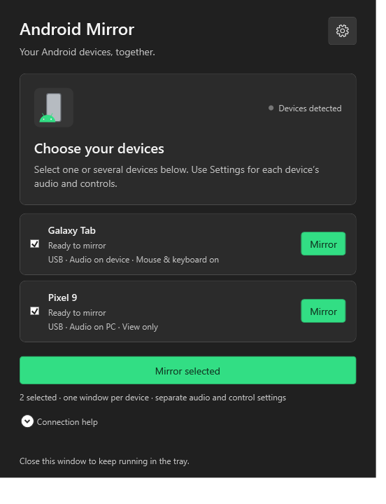
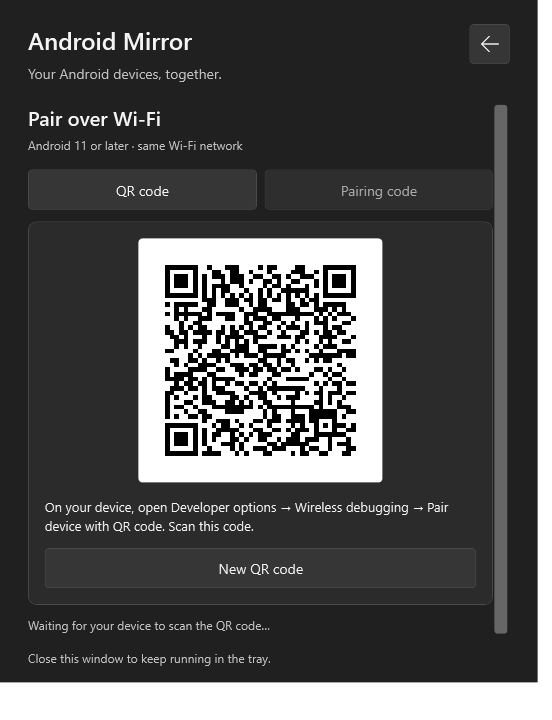
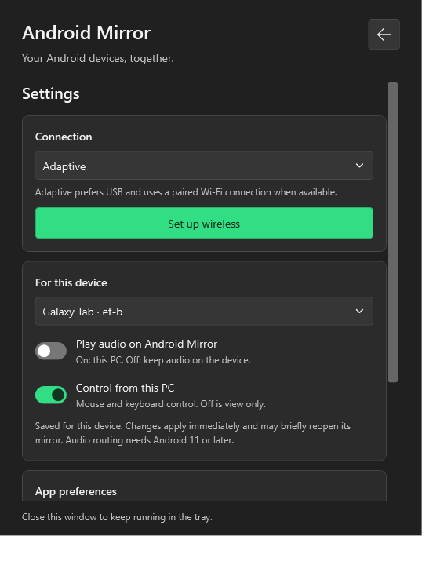
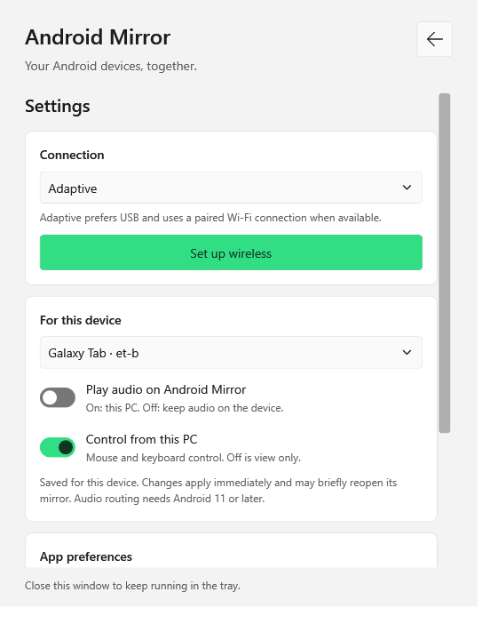

<div align="center">
  
  <h1>Android Mirror</h1>
  <p>Your Android™ devices, together on Windows.</p>
  <p>A simple native desktop app for mirroring, automatic reconnection, and wireless pairing.</p>
  <p>
    <a href="https://github.com/ExelecAKL/Android-Mirror/releases/latest">Download</a> ·
    <a href="#getting-started">Getting started</a> ·
    <a href="docs/USAGE.md">User guide</a> ·
    <a href="docs/CHANGELOG.md">What's new</a>
  </p>
  <p><strong>Windows 10 / 11</strong> &nbsp;·&nbsp; <strong>64-bit</strong> &nbsp;·&nbsp; <strong>Native WPF</strong></p>
</div>

---

<div align="center">
  
  
</div>

<p align="center"><sub>Actual app screens with demonstration devices. Glass effects follow Windows transparency settings.</sub></p>

## Made for everyday mirroring

| | What you get |
| :-- | :-- |
| **Reconnect automatically** | Unplug a selected device and plug it back in. Its mirror returns when the connection is ready. |
| **One device or several** | Mirror your phone and tablet at the same time, each in its own window. |
| **Audio where you want it** | Send audio to your PC, or leave it playing on the device. |
| **Control is optional** | Use your mouse and keyboard, or switch a device to view only. |
| **USB and Wi-Fi** | Choose USB only, Wireless only, or Adaptive. Pair with a QR code or a six-digit code inside the app. |
| **Quiet in the tray** | Close the launcher to keep detection running. Restore it from the native Windows tray menu. |
| **A familiar Windows feel** | System, light, and dark themes; acrylic where supported; subtle motion; your Android Mirror logo throughout. |

All options live behind one **Settings** icon. Audio and control choices are saved separately for every device.

## Getting started

### Install

1. Download **Android-Mirror-1.1.0-Setup.exe** from [Releases](https://github.com/ExelecAKL/Android-Mirror/releases/latest).
2. Run the installer and approve the Windows elevation prompt.
3. Open **Android Mirror** from Start.

The installer uses `C:\Program Files\Android Mirror`, adds a Start menu shortcut, and registers an uninstaller in Windows Settings. Desktop shortcuts are optional. This release is distributed directly through GitHub; it is not a Microsoft Store listing.

For a portable copy, extract **Android-Mirror-1.1.0-Windows-x64.zip** and open `Android Mirror.exe`. Keep its `engine` folder beside it. The release executables are currently unsigned.

### Connect with USB

1. Enable **Developer options → USB debugging** on your Android device.
2. Connect it using a USB cable that supports data, then accept the debugging prompt on the device.
3. Select the devices you want to mirror.

USB is the default. With **Connect automatically** enabled, the first single device connects automatically and selected devices reconnect when they return. When several devices appear for the first time, choose which ones to mirror.

### Connect over Wi-Fi

1. Put your PC and Android 11+ device on the same Wi-Fi network.
2. Open **Settings → Connection** and choose **Wireless only** or **Adaptive**.
3. Read the native Windows latency notice, then select **Yes** to continue.
4. Choose **Set up wireless**. On your device, open **Developer options → Wireless debugging**.
5. Choose **Pair device with QR code** on the device and scan the app's code, or use the app's **Pairing code** tab.

Manual pairing accepts the device IP address, pairing port, and six-digit code. If automatic discovery cannot find the connection afterward, enter the separate **connection port** from the main Wireless debugging screen and choose **Connect**. ADB commands run in the background without opening a terminal.

| Mode | Behavior |
| :-- | :-- |
| **USB only** | Mirrors USB devices and skips wireless pairing and discovery. |
| **Wireless only** | Mirrors devices connected over Wi-Fi. |
| **Adaptive** | Prefers USB for the same physical device and switches to an available paired Wi-Fi connection when USB is lost. |

Wireless may add delay or stutter. Use USB for the lowest latency. Adaptive handover briefly reopens the affected mirror; it is not a continuous video stream across transports.

## Your devices, your settings

Open **Settings**, choose a device under **For this device**, and adjust:

| Example | Play audio on Android Mirror | Control from this PC |
| :-- | :--: | :--: |
| Phone: listen on the PC, view only | On | Off |
| Tablet: keep its audio, use mouse and keyboard | Off | On |

Changing audio or controls briefly reopens only that device's active mirror. Audio forwarding requires Android 11 or later; protected content and device restrictions can limit capture. Turning PC control off also disables clipboard synchronization for that mirror.

Closing a mirror pauses that device. Closing the launcher keeps it in the tray. Choose **Quit Android Mirror** from the tray menu to stop the app and its mirrors.

<details>
<summary><strong>Settings and appearance</strong></summary>

<p align="center">
  
  
</p>

The app follows Windows light/dark mode by default. Theme overrides, automatic reconnection, and optional **Start with Windows** are in Settings. Motion and transparency respect Windows accessibility preferences. Preferences are stored per user in `%LOCALAPPDATA%\Android Mirror\settings.xml`; pairing codes and QR secrets are never stored there.

</details>

## Build from source

Requires Windows x64 and .NET Framework 4.8. The build uses the compiler included with Windows; Node.js and Visual Studio are not required.

```powershell
powershell -NoProfile -ExecutionPolicy Bypass -File .\src\build.ps1
powershell -NoProfile -ExecutionPolicy Bypass -File .\src\build-setup.ps1
powershell -NoProfile -ExecutionPolicy Bypass -File .\src\fetch-runtime-sources.ps1
powershell -NoProfile -ExecutionPolicy Bypass -File .\src\build-release.ps1
```

The first command builds the app and runs the connection tests. The second builds and validates the installer. The third downloads and verifies matching upstream runtime sources. The last creates the portable ZIP, versioned installer, runtime source bundle, release notes, and checksums in `releases/1.1.0`.

```text
Android Mirror.exe   Desktop app
engine/              Bundled mirroring and device tools
assets/              Vector logo and README screenshots
src/                 Native app, installer, build scripts, and tests
vendor/              Pinned QR code dependency
docs/                Usage, design, changelog, and validation notes
licenses/            Original third-party licence texts
installer/           Generated installer (local build)
build/               Generated tools and checks (local only)
releases/            Versioned release packages (local only)
archive/             Preserved files from the old layout (local only)
```

The compatibility launchers `scrcpy.exe` and `scrcpy-connect.exe` open Android Mirror. The original command-line engine remains in `engine/`. [Validation notes](docs/VALIDATION.md) describe what has been checked and what still requires physical devices.

## Credits and licences

Android Mirror is an independent Windows project. It is not an official Google product and is not affiliated with or endorsed by Google.

- **Android and Google:** Android is a trademark of Google LLC. Android platform and ADB work are credited to Google and the Android Open Source Project. See Google's [Android brand guidelines](https://developer.android.com/distribute/marketing-tools/brand-guidelines).
- **Logo:** The Android Mirror composition was supplied by this project's creator. The Android robot is reproduced or modified from work created and shared by Google and used according to terms described in the [Creative Commons 3.0 Attribution License](https://creativecommons.org/licenses/by/3.0/).
- **Mirroring engine:** [scrcpy](https://github.com/Genymobile/scrcpy), by Genymobile, Romain Vimont, and contributors, is bundled unchanged under Apache 2.0. Its [original licence](licenses/scrcpy-LICENSE.txt) is retained.
- **QR codes:** [QRCoder](https://github.com/Shane32/QRCoder), by Raffael Herrmann, Shane Krueger, and contributors, under the [MIT licence](licenses/QRCoder-LICENSE.txt).
- **Runtime libraries:** FFmpeg, SDL, libusb, and their dependencies retain their respective authorship and licences. See [third-party notices](licenses/THIRD-PARTY.md).

Project code is distributed under [Apache 2.0](LICENSE.txt). Third-party code, trademarks, and artwork remain subject to their own terms. [NOTICE.txt](NOTICE.txt) records attribution; it does not transfer ownership to Google or the Android project.
